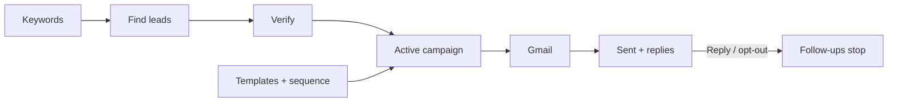

# LeadMiner · operator quick guide

**Open:** [LeadMiner dashboard](https://leadminer-app.vercel.app/login) · Sign in with your operator account. Already hosted; no install needed.

## How it works

Automation discovers and verifies leads, plans outreach daily, and dispatches due email every 15 minutes.

## Operating rhythm

| When | Check |
|---|---|
| **Every 2–3 days** | [Sign in to Gmail](https://mail.google.com/) for both sending accounts and check replies directly. LeadMiner’s **Replies** tab may miss replies; use it as a secondary check. Reply from Gmail; choose **Stop** in LeadMiner for opt-outs. |
| **Every 2–3 days** | Sign in to **Telegram**, open the LeadMiner alerts group, and review messages. Enable notifications; ask **Rohit** for group access if needed. |
| **Every 7 days** | On **Gmail Accounts**, refresh/reconnect both inboxes; confirm **ACTIVE** and the timer reset. |
| **Every 15 days** | Test one revised template; change one thing at a time and compare replies ÷ sent with the previous version. See **Change copy safely** below. |
| **When checking operations** | **Overview:** status/activity/quotas. **Campaigns:** correct campaign active and targets/limits. **Jobs / Logs:** investigate stalls or errors before retrying. |

If Gmail shows a reply missing from LeadMiner, suppress that contact in **Leads** so follow-ups stop.

**Keywords / Leads** monitor discovery and verification. Use **Find Creators Now** or **Verify Pending Emails** only to run one manual batch.

## Gmail · reconnect every 7 days

**Sending inboxes:** Rohit (`rohitbagwork@gmail.com`) · Aadarsh Work (`aadarshcwork@gmail.com`)

LeadMiner warns around day 5. On **Gmail Accounts**, click **Refresh** for an active inbox or **Reconnect / Reconnect Now** if expired or in `AUTH_ERROR`. Choose the **same Google account**, approve access, then confirm **ACTIVE** and a reset timer for both inboxes.

**Never use Disconnect to renew.** It revokes access and stops that inbox from sending.

## Change copy safely

1. In **Settings**, pause all sending.
2. In **Templates**, edit, preview, and save the campaign’s existing template. In **Sequences**, edit follow-up copy/timing and click **Save Sequence**.
3. Review the saved copy, then resume sending in **Settings**.

Active campaigns send automatically to eligible verified leads. The dashboard can’t create campaigns or change their targeting/limits. **Send Emails Now** sends up to 3 due emails across campaigns; it is not a preview.

## Stop / recover

- **Stop all email temporarily:** pause in **Settings**. Discovery and verification continue.
- **Stop one campaign:** choose **Pause** in **Campaigns**. This cancels emails already queued for sending in that campaign.
- **Unsure what sent?** Check **Sent** and **Jobs** before taking action. Don’t repeatedly trigger sends.
