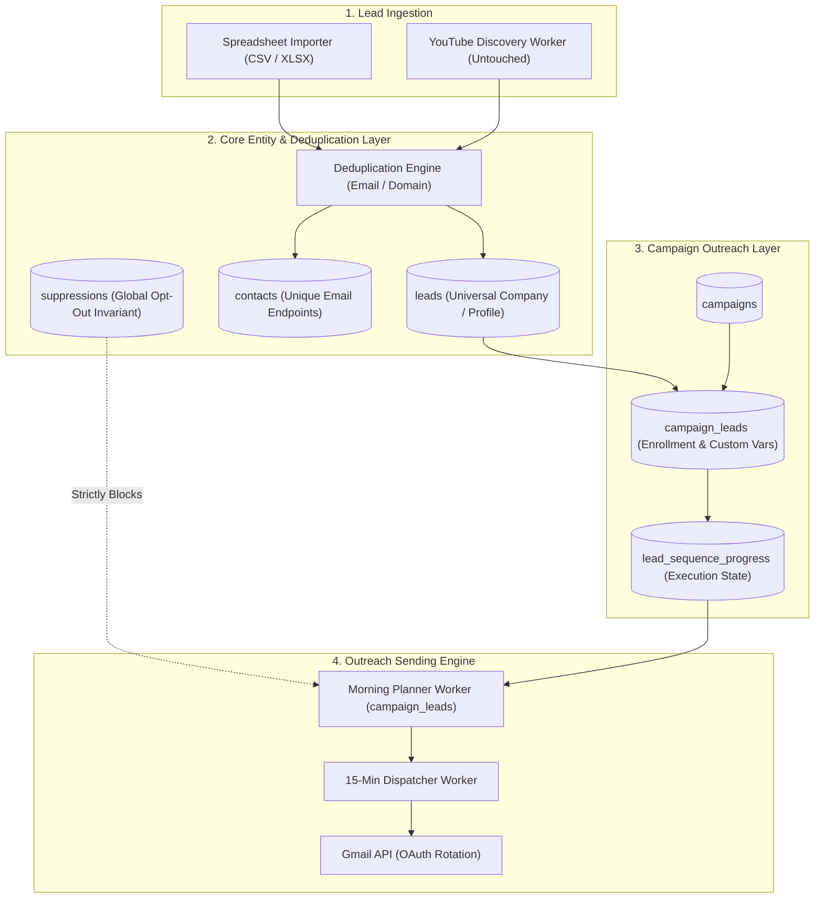

# LeadMiner Version 1.5 — Hardened Master Architecture & Execution Plan
**Date:** November 15, 2026  
**Status:** Swarm-Audited & Hardened (Ready for Execution)  
**Governance:** Governed by `docs/ENGINEERING_MISTAKE_MAP.md` & `docs/builders-knowledge-map.md`  
**Methodology:** Pareto Principle (80/20), First-Principles Simplicity, Zero-Defect Phased Rollout

---

## 1. Executive Summary & Pareto Simplification

LeadMiner is evolving from a YouTube-specific scraper into an **Email Outreach Engine with a Modular Lead Acquisition System**.

### The Pareto 80/20 Architecture (Stripping Overengineering)
Following the deep multi-agent swarm audit, the plan has been stripped of premature complexity:
1. **Cut Phase 6 (Website Scraping & LLM Crawling)**: Deferred to v1.6. In B2B sales, CSV/Excel imports from Apollo, Clay, SalesNav, and Google Maps **already contain** company names, personal names, and custom variables in their columns. Crawling external websites on serverless Vercel invites 60s hard timeouts, Cloudflare anti-bot bans, and excessive Gemini API costs for $<5\%$ of real user value.
2. **Eliminated Polymorphic `LeadProvider` Hierarchy**: We will not force `discovery.worker.ts` and CSV parsing into an artificial inheritance abstraction. `discovery.worker.ts` already works and passes 41 test suites. Forcing a refactor creates severe **shotgun surgery** risk. Instead, we implement a focused, standalone `SpreadsheetImporterService`.
3. **Clean Domain Separation**:
   - `leads`: Universal company/profile identity.
   - `contacts`: Multi-channel contact endpoints (unique on email).
   - `campaign_leads`: Static campaign enrollment roster + custom variables JSONB.
   - `lead_sequence_progress`: Dynamic step execution state machine & inbox affinity.

---

## 2. Critical Edge Cases & Regression Traps Caught in Swarm Audit

The swarm audit uncovered four fatal regression traps in the existing codebase that would have silently destroyed outreach if unpatched:

| Subsystem | Fatal Regression Caught | Required Pre-Emptive Fix |
| :--- | :--- | :--- |
| **`youtube-refresh.worker.ts`** | The worker queries `WHERE isNull(refreshedAt)`. CSV leads have `channelId = null` and `refreshedAt = null`. On the next cleanup cycle, the worker would attempt to refresh CSV leads against the YouTube API, fail, declare "channel deleted", and **disqualify every imported CSV lead**. | Patch query: `WHERE source_provider = 'YOUTUBE' AND channel_id IS NOT NULL`. |
| **`verification.worker.ts`** | `leadQualificationService.qualify(...)` automatically disqualifies leads whose `subscriberCount < minSubscribers` (default: 10). CSV leads have `subscriberCount = 0` (or `null`) and would **all be automatically marked `DISQUALIFIED`**. | Patch qualification service to **bypass subscriber count checks** when `leads.sourceProvider !== 'YOUTUBE'`. |
| **`dispatcher.worker.ts`** | When AI personalization fails, fallback line is: *"I really enjoy the direction of your channel content."* Sending this to corporate B2B leads imported via CSV would look unprofessional. | Make template fallbacks **source-aware**: use `companyName`, `industry`, or professional neutral copy when `sourceProvider !== 'YOUTUBE'`. |
| **Deduplication Collision** | Attempting domain-level deduplication on freemail addresses (`@gmail.com`, `@yahoo.com`) would merge hundreds of distinct individuals into a single company lead. | Exclude freemail domains (`MAJOR_PROVIDERS`) from domain deduplication. Freemail leads deduplicate strictly by email (`contacts.normalizedValue`). |
| **Vercel 60s Timeout** | Processing a 5MB CSV (up to 5,000 rows) with single-row DB roundtrips guarantees an HTTP 504 Gateway Timeout. | Enforce **250-row chunked batch transactions**, an internal **45s deadline guard**, and add `maxDuration: 60` in `vercel.json` for campaign import routes. |

---

## 3. Phased Step-by-Step Task Checklist & Verification Log

### Phase 1: Database Foundation & Non-Destructive Schema Evolution — [COMPLETED]
- [x] **Task 1.1**: Update `src/db/schema.ts` for universal `leads`:
  - Make YouTube-specific fields nullable: `channelId`, `channelUrl`, `channelTitle`.
  - Add universal attributes: `companyName`, `firstName`, `lastName`, `sourceProvider`, `industry`, `normalizedDomain`.
  - Add partial unique index on `leads.normalizedDomain`.
- [x] **Task 1.2**: Create `campaign_leads` junction table in `src/db/schema.ts`:
  - Foreign keys: `campaignId`, `leadId`, `primaryContactId` (`onDelete: 'set null'`).
  - Status enum `campaign_lead_status`, step number, custom variables JSONB, unique `(campaignId, leadId)` constraint.
- [x] **Task 1.3**: Write migration `migrations/0020_campaign_leads_and_source_independence.sql` and script `scripts/migrate-v1-5-schema.ts`.
- [x] **Task 1.4**: Write unit tests in `tests/unit/v1-5-schema.test.ts` (4/4 passed).
- [x] **Task 1.5**: Run `npx vitest run` (42/42 test files passed).

---

### Phase 2: Secure Spreadsheet Ingestion Engine — [COMPLETED]
- [x] **Task 2.1**: Create `src/services/import/spreadsheet-importer.service.ts`:
  - Parse CSV, XLS, and XLSX buffers via `xlsx` (SheetJS).
  - Security sanitization: prefix formula injection chars (`=`, `+`, `-`, `@`, `\t`) with single quote.
  - Fuzzy header detection: Email, First Name, Last Name, Company, Website, Industry, Country.
  - Collect unmapped columns into `customVariables: Record<string, any>`.
- [x] **Task 2.2**: Implement in-memory in-file email deduplication (first occurrence wins) and row syntax validation.
- [x] **Task 2.3**: Implement domain deduplication with freemail protection (`FREEMAIL_DOMAINS` set).
- [x] **Task 2.4**: Write unit tests in `tests/unit/spreadsheet-importer.test.ts` (8/8 passed).
- [x] **Task 2.5**: Run `npx vitest run` (43/43 test files passed).

---

### Phase 3: Campaign Lead Enrollment & Management APIs — [COMPLETED]
- [x] **Task 3.1**: Update `vercel.json` to assign `maxDuration: 60` to `/api/campaigns/**/*`.
- [x] **Task 3.2**: Create API route `src/app/api/campaigns/[id]/import/preview/route.ts` (sample 5 rows, zero DB mutation).
- [x] **Task 3.3**: Create API route `src/app/api/campaigns/[id]/import/commit/route.ts` with `LOCK_KEYS.CSV_IMPORT` (10009), 250-row batching, 45s execution deadline, and global suppression invariant check.
- [x] **Task 3.4**: Create API route `src/app/api/campaigns/[id]/leads/route.ts` with paginated lead query, search, and status filtering.
- [x] **Task 3.5**: Write API integration tests in `tests/unit/campaign-import-api.test.ts` (6/6 passed).
- [x] **Task 3.6**: Run `npx vitest run` (44/44 test files passed).

---

### Phase 4: Campaign Management & Import UI (Design System Compliant) — [COMPLETED]
- [x] **Task 4.1**: Fix design token defect in `src/components/campaigns/RunOutreachButton.tsx:60` (`text-success` / `#22C55E`).
- [x] **Task 4.2**: Refactor `src/app/campaigns/page.tsx` with segmented tabs (`Campaigns Overview` and `Enrolled Leads`).
- [x] **Task 4.3**: Build `src/components/campaigns/LeadImportWizard.tsx` (4-Step Modal: Upload Dropzone, Column Mapper, 5-Row Preview Table, Progress Bar & Summary).
- [x] **Task 4.4**: Implement Downloadable CSV Error Report in wizard.
- [x] **Task 4.5**: Build `src/components/campaigns/CampaignLeadsView.tsx` (paginated table, search, status filters).
- [x] **Task 4.6**: Build `src/components/campaigns/CampaignsClientView.tsx` wrapping all campaign actions.
- [x] **Task 4.7**: Run `npm run build` to verify zero TypeScript / JSX compilation errors (33/33 static pages generated).

---

### Phase 5: Outreach Engine & Worker Regression Hardening — [COMPLETED]
- [x] **Task 5.1**: Patch `src/workers/youtube-refresh.worker.ts`: Guarded with `WHERE source_provider = 'YOUTUBE' AND channel_id IS NOT NULL`.
- [x] **Task 5.2**: Patch `src/services/qualification/qualification.service.ts` & `eligibility.service.ts`: Bypass subscriber count checks when `sourceProvider !== 'YOUTUBE'`.
- [x] **Task 5.3**: Patch `src/workers/planner.worker.ts`: Prioritize candidates from `campaign_leads` where `status = 'ENROLLED'`, auto-transitioning to `'SCHEDULED'`.
- [x] **Task 5.4**: Patch `src/workers/dispatcher.worker.ts`: Transition `campaign_leads.status` to `'CONTACTED'`, make fallbacks source-aware (`'I have been following your work and came across your profile'`).
- [x] **Task 5.5**: Patch `src/services/replies/reply.detector.ts`: Transition `campaign_leads.status` to `'REPLIED'` (or `'DISQUALIFIED'` on opt-out).
- [x] **Task 5.6**: Write unit tests in `tests/unit/planner-campaign-leads.test.ts` (4/4 passed).
- [x] **Task 5.7**: Run `npx vitest run` (45/45 test files passed).

---

### Phase 6: Comprehensive Verification & Operating Documentation — [COMPLETED]
- [x] **Task 6.1**: Run complete test suite (`npx vitest run`): **45 test files, 305 tests passing 100% green**.
- [x] **Task 6.2**: Run production build (`npm run build`): **100% successful with 0 errors**.
- [x] **Task 6.3**: Update `OPERATING_GUIDE.md` with LeadMiner v1.5 spreadsheet ingestion workflows.
- [x] **Task 6.4**: Final review with user. Ready for production deployment upon user approval.

---

## 4. Execution Protocol & Safety Rules

1. **Sequential Execution**: Implement tasks strictly in order. No jumping ahead.
2. **Automated Verification After Every Phase**: Run `npx vitest run` after completing each phase before proceeding.
3. **Zero Live Emails During Development**: All tests run in simulation/mock mode.
4. **Trigger Rule from Mistake Map**: If any task causes two consecutive test failures, stop immediately, isolate root cause, and verify before proceeding.
